<picture><source media="(prefers-color-scheme: dark)" srcset="assets/hero-dark.svg"></picture>

<picture><source media="(prefers-color-scheme: dark)" srcset="assets/social-l-dark.svg"></picture><a href="https://discord.com/users/690499153775558719"><picture><source media="(prefers-color-scheme: dark)" srcset="assets/social-1-dark.svg"></picture></a><a href="https://www.youtube.com/@lobothexile"><picture><source media="(prefers-color-scheme: dark)" srcset="assets/social-2-dark.svg"></picture></a><picture><source media="(prefers-color-scheme: dark)" srcset="assets/social-r-dark.svg"></picture>

<picture><source media="(prefers-color-scheme: dark)" srcset="assets/about-dark.svg"></picture>

<picture><source media="(prefers-color-scheme: dark)" srcset="assets/wave-dark.svg"></picture>

<picture><source media="(prefers-color-scheme: dark)" srcset="assets/stack-dark.svg"></picture>

<a href="https://github.com/LoboThExile/SecurityAlarmArduino"><picture><source media="(prefers-color-scheme: dark)" srcset="assets/project-securityalarmarduino-dark.svg"></picture></a>&nbsp;<a href="https://github.com/LoboThExile/The-Wild-Hunt"><picture><source media="(prefers-color-scheme: dark)" srcset="assets/project-the-wild-hunt-dark.svg"></picture></a>

<a href="https://github.com/LoboThExile/Pointmatch"><picture><source media="(prefers-color-scheme: dark)" srcset="assets/project-pointmatch-dark.svg"></picture></a>&nbsp;<a href="https://github.com/LoboThExile/SemestraEnterprise"><picture><source media="(prefers-color-scheme: dark)" srcset="assets/project-semestraenterprise-dark.svg"></picture></a>

<picture><source media="(prefers-color-scheme: dark)" srcset="assets/stats-dark.svg"></picture>

<picture><source media="(prefers-color-scheme: dark)" srcset="assets/streak-dark.svg"></picture>

<a href="https://guns.lol/lobothexile"><picture><source media="(prefers-color-scheme: dark)" srcset="assets/button-1-dark.svg"></picture></a>&nbsp;&nbsp;<a href="https://github.com/LoboThExile?tab=repositories"><picture><source media="(prefers-color-scheme: dark)" srcset="assets/button-2-dark.svg"></picture></a>

<a href="https://metawka.github.io/expressive-profile/?from=lobothexile"><picture><source media="(prefers-color-scheme: dark)" srcset="assets/credit-dark.svg"></picture></a>

